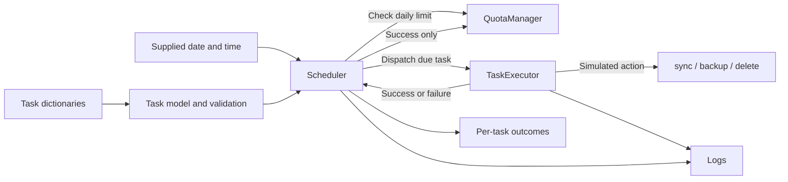

# Strategy Task Scheduler

A small **simulated** Python task scheduler for the interview exercise in [`context.md`](context.md). It separates task input, per-user daily quotas, action dispatch, and due-time scheduling. Actions named `sync`, `backup`, and `delete` log successes but do **not** modify files.

## Architecture



**In simple terms:** The `Task` model checks each submitted task's data. The `Scheduler` compares its daily scheduled time with the supplied clock and skips tasks already completed that day. It asks `QuotaManager` whether the user has a slot, then asks `TaskExecutor` to simulate the action. Only a successful action uses a quota slot; failures can be retried while due. The scheduler returns a status for each due task, and the executor and scheduler log what happened. All state is held in memory.

## Run

Requires Python 3.11 or newer. From the repository root:

```bash
python -m strategy_scheduler 2026-10-07T12:00
```

The optional argument is a local `YYYY-MM-DDTHH:MM` timestamp. Without it, the example uses the current local time; sample tasks are due at `12:00`. The example logs outcomes to stderr. Integrators can create users with `QuotaManager({"alice": 3})`, load task dictionaries using `Task.from_dict(...)`, register them with `Scheduler.add_task(...)`, and call `Scheduler.run_due(datetime(...))` to receive structured outcomes.

## Verify

```bash
python -m unittest discover -s tests -v
python -m pip install ruff
ruff check .
```

GitHub Actions runs the same tests and linter on pushes and pull requests. See the [local verification report](docs/test-results.md). There are no credentials or environment variables to configure; hence no `.env.example` is needed. `.gitignore` excludes local secrets and Python/tool artifacts.

## Decisions and limitations

- Each task has a stable unique ID, a user, daily `HH:MM` schedule, action, target, and optional dictionary of parameters. Multiple tasks for one user may be due at once.
- A user's quota counts **successful executions only**, per supplied local calendar date. Failed tasks remain retryable while due. Successful tasks run at most once per date, even when the scheduler is called again that minute; retries next day are allowed. Tasks are considered in registration order.
- Invalid input, duplicate IDs, unknown users or actions, failures, and quota skips are handled explicitly. Logs include task ID and user; returned outcomes include a status.
- This is in memory and synchronous. Restarting loses quota and completion records; simultaneous scheduler invocations are not atomic. No persistent scheduler runs automatically, missed minutes are not replayed, and production deployments need a deliberate timezone and durable atomic quota management.

## AI-assisted refactoring

AI was used to sketch module boundaries and edge cases, then the proposed design was checked against `context.md`. A database, async workers, real filesystem actions, and an API were intentionally rejected as unnecessary for a small simulated exercise. Focused tests, a runnable example, and Ruff linting verify the implementation locally; CI runs the same checks after push. The design and implementation plan are in `docs/superpowers/`.
